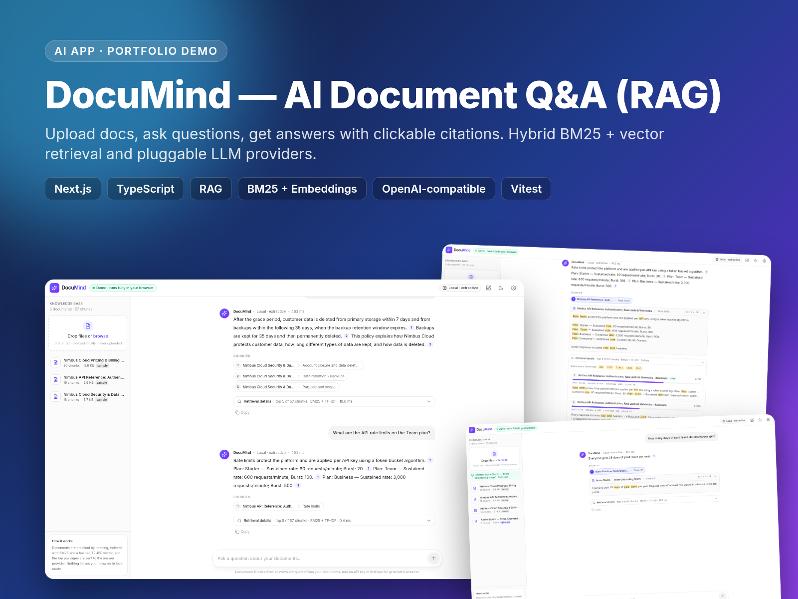
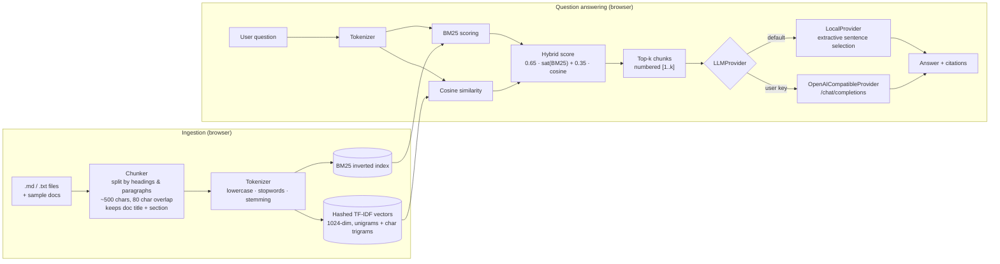
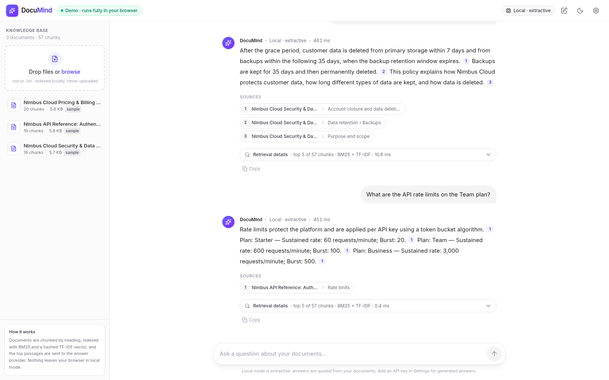
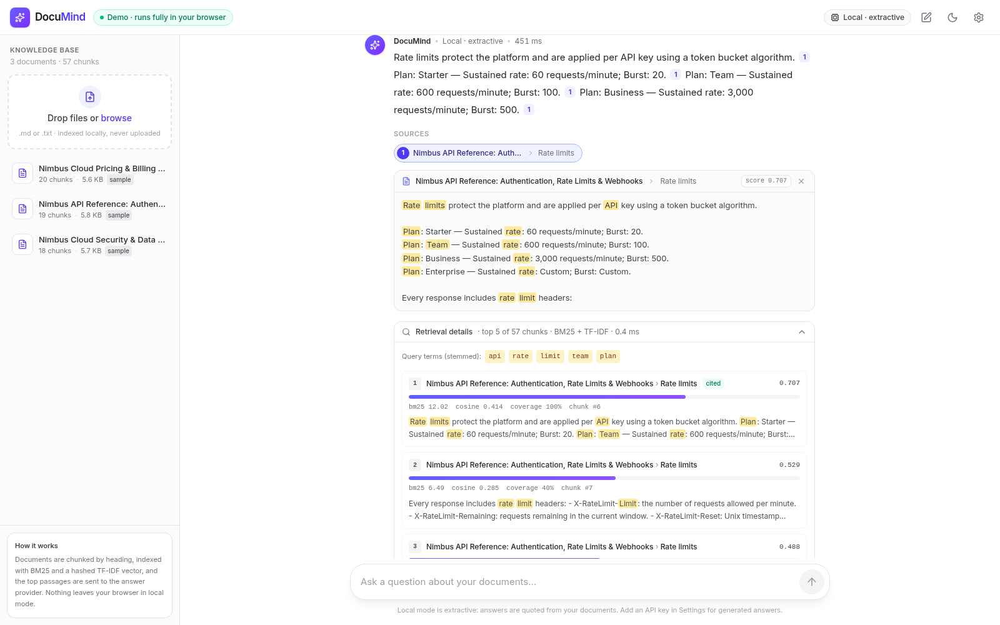
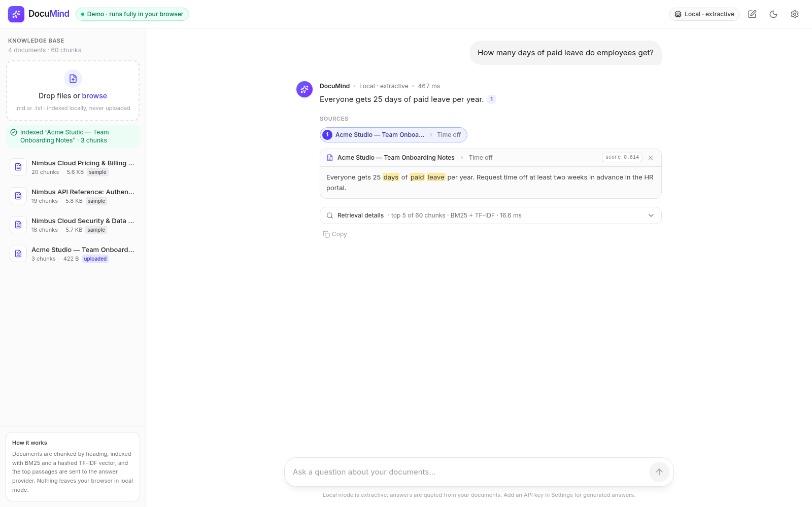

# DocuMind — AI document Q&A chatbot (RAG)

DocuMind is a chat-with-your-docs assistant built on retrieval-augmented generation (RAG). Drop in Markdown or text files and ask questions in plain English. DocuMind splits the documents into chunks, ranks them with a hand-written BM25 + hashed TF-IDF hybrid retriever, and answers with inline citations like `[1]`. Click a citation to see the exact source passage with the matching terms highlighted. Everything, including indexing, retrieval and the default answer engine, **runs entirely in your browser** as a static site. There is no backend and no API key is required. When you want generated answers instead of extracted ones, paste your own OpenAI-compatible key in Settings.

**Live demo:** https://huynhduydong.github.io/ai-docs-chatbot-rag/



> The preloaded knowledge base describes **Nimbus Cloud**, a fictional company invented for this demo. All prices, endpoints and policies in it are made up.

## Features

- **Chat UI similar to ChatGPT and Perplexity.** User and assistant bubbles, a streaming-style typing effect, starter questions on the empty screen, copy button, light/dark theme and a responsive layout with a mobile drawer.
- **Cited answers.** Each `[n]` marker links to a source chip (`[1] Doc title › Section`). The chip expands to show the source snippet with the query terms highlighted.
- **Retrieval details panel.** Shows the top-k chunks with hybrid score, raw BM25, cosine similarity, term coverage, and which chunks were actually cited. Useful for explaining and debugging the RAG pipeline.
- **Honest refusals.** If retrieval confidence is low, DocuMind replies "I couldn't find that in the documents" instead of guessing.
- **Client-side ingestion.** Drag and drop (or browse for) `.md` / `.txt` files. They are chunked and indexed instantly, appear in the sidebar with chunk counts, and can be removed.
- **Pluggable LLM providers.**
  - `LocalProvider` (default): extractive and deterministic, no key, no network.
  - `OpenAICompatibleProvider`: works with any `/chat/completions` API. The key is stored only in `localStorage`.
- **Static export.** Deploys to GitHub Pages with the included workflow.

## Architecture



| Module | Responsibility |
| --- | --- |
| `src/lib/rag/chunker.ts` | Markdown-aware chunking. Turns tables into row sentences, strips inline markdown, never crosses section boundaries, and adds sentence-level overlap. |
| `src/lib/rag/tokenizer.ts` | Lowercasing, stopword removal and a small Porter-style suffix stemmer. |
| `src/lib/rag/bm25.ts` | Okapi BM25 (k1 = 1.5, b = 0.75) with an incremental inverted index (add/remove documents). |
| `src/lib/rag/embedding.ts` | Model-free "embedding": TF-IDF-weighted stems plus character trigrams, hashed (FNV-1a, signed) into 1024 dimensions and L2-normalised. |
| `src/lib/rag/retriever.ts` | Hybrid re-scoring. BM25 is squashed to [0, 1) with `1 − e^(−s/6)` so scores can be blended and thresholded. |
| `src/lib/providers/` | The `LLMProvider` interface, the local extractive provider, the OpenAI-compatible provider, and citation renumbering. |

```ts
interface LLMProvider {
  id: string;
  name: string;
  answer(question: string, contexts: ScoredChunk[]): Promise<{ text: string; citations: Citation[]; grounded: boolean }>;
}
```

## Stack

Next.js 15 (App Router, static export) · React 19 · TypeScript · Tailwind CSS v4 · lucide-react · Vitest. Retrieval and ranking use no external ML libraries or models.

## Getting started

```bash
npm i          # install dependencies
npm run dev    # http://localhost:3000
npm test       # unit tests for tokenizer, chunker, BM25/hybrid retriever and providers
npm run build  # static export to ./out
```

To build for a sub-path, such as GitHub Pages project sites, set `BASE_PATH`:

```bash
BASE_PATH=/ai-docs-chatbot-rag npm run build
```

`.github/workflows/deploy.yml` does this automatically on every push to `main`. In the repository settings, set **Settings › Pages › Source** to **GitHub Actions**.

## Plugging in a real LLM

The default **local mode is extractive**. It needs no LLM or API key: it selects the sentences from the top passages that best cover your question and stitches them into an answer with citations. To get generated answers:

1. Click the provider badge or the gear icon in the header to open **Settings**.
2. Choose **OpenAI-compatible**, then enter the **Base URL** (default `https://api.openai.com/v1`), your **API key**, and a **model** (default `gpt-4o-mini`).
3. Click **Save**. The header badge switches to `LLM · <model>`.

The key is saved only in your browser's `localStorage` and is sent directly from your browser to the base URL you entered. It is never part of the build. The system prompt tells the model to answer only from the numbered context passages, cite them as `[n]`, and say it couldn't find the answer otherwise. Any provider that exposes an OpenAI-compatible `/chat/completions` endpoint and allows browser (CORS) requests will work, for example OpenAI, OpenRouter, Groq, or a local Ollama / LM Studio server.

## Screenshots

| Chat | Citations | Upload |
| --- | --- | --- |
|  |  |  |

## License

MIT © Huynh Duy Dong. See [LICENSE](LICENSE).
